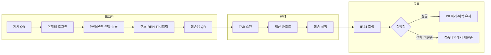
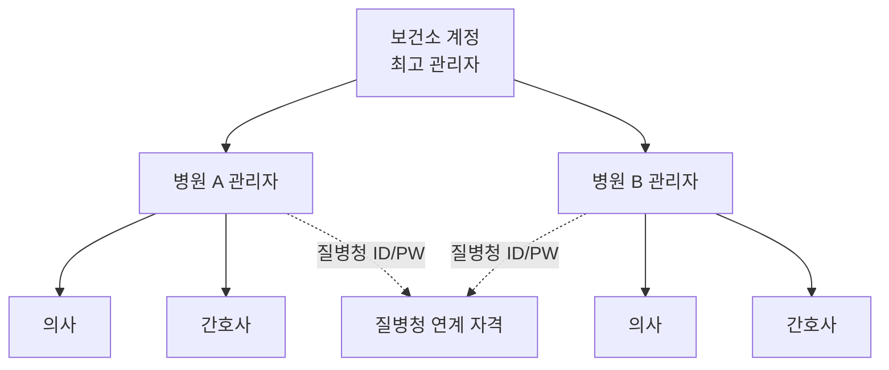
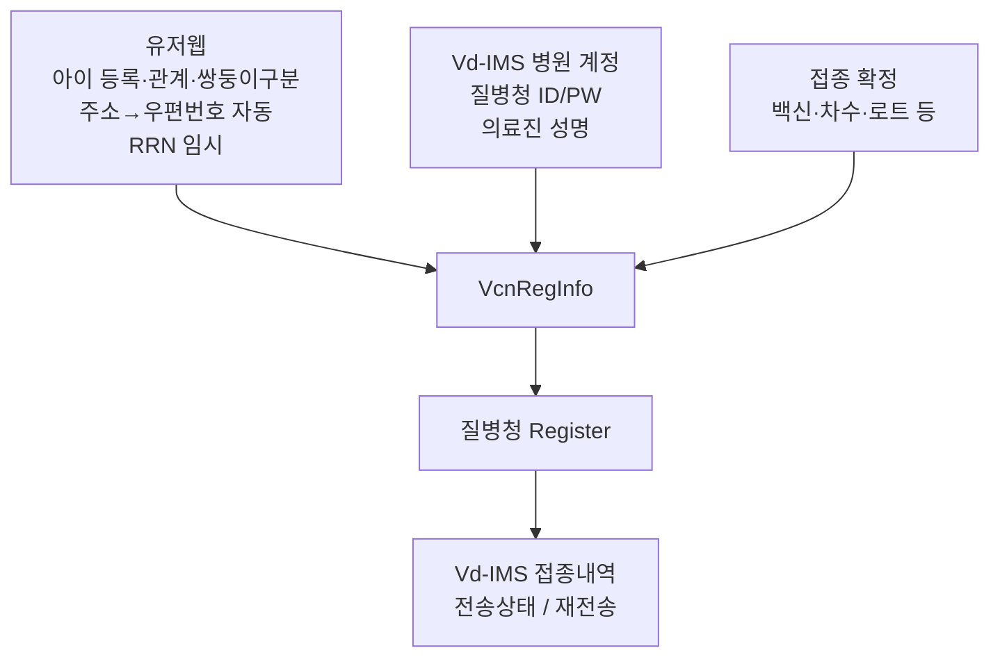

# 보건소 구축형 — 프로세스 그림 & 작업 목록

| 항목 | 내용 |
|------|------|
| 문서 버전 | v0.2 |
| 작성일 | 2026-08-18 |
| 관련 | `구축형_서비스_프로세스_정리_v0.1.md`, `IR24_필수값_화면_테이블_매핑표_v0.1.md` |

---

## 1. 의학적 소견 — 필수 여부

**필수 아님 (선택).**

| 근거 | 내용 |
|------|------|
| IR24 §2.2 접종정보 | `mdccom`(의학적소견) = **△ 선택** |
| IR24 §4.2 필수검사 | 접종코드·차수·일자·로트·유효기간·백신약품코드만 검사. **소견 없음** |
| IR24 §5.2 DB | `MDCCOM` = Null 허용(Y) |

→ Vd-IMS/접종 화면에서는 **선택 입력**으로 두고, 질병청 전송 시 값이 있으면 넣고 없으면 생략하면 됩니다.

---

## 2. 단순화 프로세스 그림

### 2.1 전체 한눈에



### 2.2 역할·권한 구조



- **보건소 최고 관리자**: 하위 병원(기관) 계정·권한 관리, 테넌트 총괄  
- **병원 관리자**: 병원 계정·의료진 계정, **질병청 기관 ID/PW** 입력, 접종내역·재전송  
- **의사 / 간호사**: 접종 확정(계정에 접종자·예진의 정보), 현장 업무  

### 2.3 데이터 어디서 모이나



### 2.4 Vd-IMS 접종내역 (전송·재전송)

```text
접종내역 목록
├─ (기존) 접종일시, 성명, 감염병, 유무료, 백신, 로트, 자가체크 …
├─ [추가] 질병청 전송상태 : 미전송 | 전송실패 | 전송완료
└─ [추가] 미전송·전송실패 시 → [재전송] 버튼
         · 재전송 = 동일 건으로 Register 재호출
         · 성공 시 상태 → 전송완료, (대기 중이면) PII 파기 정책 적용
```

---

## 3. 이번 확정 반영 요약

| 항목 | 확정 내용 |
|------|-----------|
| OCS | 연동 안 함 |
| 질병청 ID/PW | **병원(기관) 계정**에 입력 |
| 의료진명 | Vd-IMS **계정 상세**에 접종자·예진의 입력 |
| 아이구분(쌍둥이) | 유저웹 **아이 등록** 시 선택 + **접종 시에도 아이 등록** 가능 |
| 보호자 관계 | 아이 등록 시 설정 (`본인/부/모/자/기타`) |
| 우편번호 | 주소 저장 시 **주소 기반 자동 검색·저장** |
| 권한 | 보건소 최고관리자 → 병원(관리자·의사·간호사) |
| 접종내역 | **전송상태 표시 + 미전송/실패 시 재전송** |
| 의학적 소견 | **선택** (필수 아님) |

---

## 4. 작업 목록 (해야 할 일)

체크박스는 진행하며 표시하세요.

### A. 기획·계약·인프라

- [ ] 보건소 = 개인정보처리자 / 회사 = 수탁자 계약 문구 확정
- [ ] 공공클라우드 CSP·테넌트 분리 방식 확정 (보건소 계약 vs 대행)
- [ ] CSAP(또는 전환기 인증) 적용 여부 확인
- [ ] PIA 필요 여부·일정 확인
- [ ] 알림(카카오 등) 재위탁 범위 계약 반영
- [ ] 보건소 브랜딩·도메인·본인인증 방식(PASS 등) 확정

### B. 권한·계정 (Vd-IMS)

- [ ] 역할 모델: `보건소_최고관리자` / `병원_관리자` / `의사` / `간호사` 정의
- [ ] 보건소 하위에 병원 계정 생성·조회·권한 부여 UI
- [ ] 병원 계정에 **질병청 Usrid / Pwd** 입력·암호화 저장·마스킹 표시
- [ ] 의료진 계정 상세에 **접종자 성명·예진의사명** 필수(역할별) 입력
- [ ] 병원 관리자만 질병청 자격·하위 의료진 관리 가능하도록 권한 매트릭스

### C. 유저웹 (보건소 커스텀)

- [ ] 아이 등록: 이름, 생년월일, **보호자 관계**, **아이구분(쌍둥이)**
- [ ] 접종 플로우에서도 **아이 신규 등록** 가능
- [ ] 주소 입력 → **우편번호 자동 조회·저장**
- [ ] 접종 직전 RRN(·보호자 RRN) 임시 입력 + 단기 접종용 QR
- [ ] ACK/만료 시 PII 파기 + 파기 로그
- [ ] 동의(개인정보·SMS 등) 수집

### D. 접종 현장 (TAB · 안심예방접종)

- [ ] 접종용 QR + 백신 바코드 스캔
- [ ] 로그인 의료진 → injnam / exmdtrnam 자동 채움(필요 시 예진의 선택)
- [ ] 접종코드·차수·일자·로트·방법·부위·용량 입력/확정
- [ ] 의학적 소견 = **선택 입력**
- [ ] 확정 시 IR24 조립·전송 호출

### E. 질병청 연동 (IR24 Adapter)

- [ ] `VcnRegService.Register` 연동 (현행 SOAP)
- [ ] 백신 제조번호 조회 연동
- [ ] §4 필수값 선검증 (전송 전)
- [ ] 결과코드 → `send_yn` / `reg_status` 매핑 (IR24 §3.5 대응)
- [ ] Adapter 인터페이스로 분리 (2027 WEB·JWT 교체 대비)

### F. Vd-IMS 접종내역

- [ ] 목록에 **질병청 전송상태** 컬럼 (미전송 / 전송실패 / 전송완료)
- [ ] 미전송·전송실패 행에 **재전송** 버튼
- [ ] 재전송 권한: 병원 관리자(+ 정책에 따라 의료진)
- [ ] 재전송 이력(시각·결과·메시지) 로그
- [ ] (선택) 전송상태 필터·검색

### G. 운영·품질

- [ ] 실패 재시도 TTL / 최대 횟수 / 담당 알림
- [ ] 감사로그(누가 재전송·PII 파기했는지)
- [ ] 파일럿 보건소 E2E 시나리오 테스트
- [ ] 온보딩 체크리스트(계정·TAB·게시 QR·질병청 자격)

---

## 5. 체크해야 하는 부분 (의사결정·검증)

### 5.1 열기 전에 확인할 것

| # | 체크 항목 | 상태 | 비고 |
|---|-----------|------|------|
| 1 | 질병청 기관 ID/PW를 **병원 계정**에 두는 것 — 보건소 다병원일 때 병원별 자격인지 확인 | ☐ | 병원마다 질병청 계정이 다를 수 있음 |
| 2 | 간호사가 `injnam`만 쓰고 예진의는 의사 계정에서 고르는 UX | ☐ | |
| 3 | 접종 시 아이 등록 = 유저웹과 동일 스키마인지 (관계·쌍둥이 포함) | ☐ | |
| 4 | 우편번호 API(도로명주소 등) 공공/상용 중 무엇 쓸지 | ☐ | 질병청도 우편번호 유효성 검사 |
| 5 | 재전송 시 RRN이 이미 파기된 경우 — 재입력 유도 vs 재전송 불가 | ☐ | **중요** |
| 6 | 전송완료 후 수정(U)·삭제(D) 지원 범위 | ☐ | IR24 vact |
| 7 | 보건소 관리자가 병원 접종내역을 횡단 조회할지 | ☐ | 권한 |
| 8 | 유저웹 본인인증(카카오/네이버 vs PASS) | ☐ | 공공 적합도 |
| 9 | 14세 미만 동의·법정대리인 문구 | ☐ | 법무 |
| 10 | 차세대(2027.3) 일정과 Adapter 일정 정렬 | ☐ | 참고만, 당장 SOAP |

### 5.2 개발 완료 시 검증

| # | 검증 | 통과 |
|---|------|------|
| 1 | IR24 필수 인적·접종 필드가 빈 값 없이 조립되는가 (소견 제외) | ☐ |
| 2 | 병원 계정 질병청 ID/PW로 Register 로그인·전송 성공 | ☐ |
| 3 | 쌍둥이구분·관계가 아이 등록·접종 시 등록 모두에서 저장되는가 | ☐ |
| 4 | 주소만 넣어도 우편번호가 저장·전송되는가 | ☐ |
| 5 | 접종내역 전송상태·재전송이 실제 질병청 결과와 일치하는가 | ☐ |
| 6 | 전송 성공 후 RRN/주소가 파기되고 로그가 남는가 | ☐ |
| 7 | 보건소 관리자 ↔ 병원·의사·간호사 권한 경계가 맞는가 | ☐ |
| 8 | 의학적 소견 없이도 전송 성공하는가 | ☐ |

### 5.3 재전송·PII (특히 체크)

IR24는 전송 시 주민번호 등이 필요합니다. **성공 후 PII를 파기**하면, 이후 재전송이 막힐 수 있습니다.

권장 정책(택1, 확정 필요):

| 옵션 | 내용 |
|------|------|
| A | 미전송·실패 동안만 PII 유지 → 그 구간에서만 재전송. 성공 즉시 파기 |
| B | 재전송 필요 시 보호자에게 RRN 재입력 요청 후 재전송 |
| C | 실패 건은 짧은 TTL(예: 24~72h) 보관 후 파기, TTL 내 재전송 |

→ 기본 추천: **A + C 혼합** (실패 건 TTL 내 재전송, 성공 즉시 파기).

---

## 6. 변경 이력

| 버전 | 일자 | 내용 |
|------|------|------|
| v0.2 | 2026-08-18 | 프로세스 단순화 그림, 작업·체크 목록. 접종내역 전송상태/재전송, 병원 ID·PW, 아이등록·우편번호·관계·권한계층, 의학적소견=선택 반영 |
